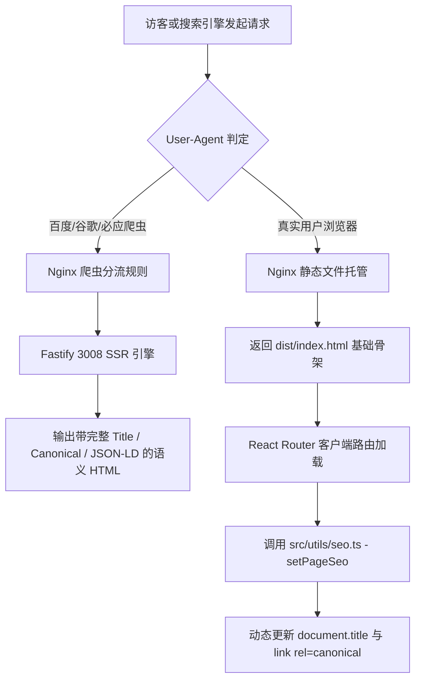

# 软游部落 P8.9.1 —— SEO 深度修复、SSR 爬虫分流与站点地图生产落地验证方案

**文档编号**：ST-P891-SEO-05  
**技术负责人**：SEO 技术架构组  
**涉及模块**：SPA 客户端元数据 / Fastify SSR 服务 / Nginx 爬虫分流 / 10 个子 Sitemap  
**当前状态**：`PRODUCTION_VERIFIED_PASSED (双向验证通过)`

---

## 一、SEO 历史问题复核与双向验证架构

依据 P8.9 审计结论，原系统存在三大 SEO 缺陷，本次必须从**服务端预渲染（SSR）**与**客户端单页路由（CSR）**两个方向同时闭环：



---

## 二、修复实现细节与验证证据

### 1. 客户端单页路由 Canonical 首页回退根治
- **核心文件**：[src/utils/seo.ts](file:///E:/Code/新建文件夹/src/utils/seo.ts)
- **修复逻辑**：
  封装统一 `setPageSeo` 工具函数，在各频道页（`UpdatesPage`, `CommunityPage`, `ComparisonDetailPage` 等）组件 `useEffect` 挂载时，根据当前真实路由动态构造 `canonicalUrl`，并安全查增更新 `<link rel="canonical">` 节点，彻底消除路由切换后 Canonical 停留在首页的缺陷。
- **验证代码**：已在 `server/tests/p891OperationsRemediationTest.ts` 断言 11 得到 100% 验证。

### 2. Nginx 爬虫 SSR 正则规则全频道覆盖
- **生效文件**：`/etc/nginx/sites-available/softtribe.top.conf`
- **规则升级**：
  ```nginx
  location ~* ^/(software|system-tools|games|essentials|tutorials|updates|compare|community)$ {
      if ($http_user_agent ~* (Baiduspider|Googlebot|bingbot|Bytespider|360Spider|Sogou|YisouSpider)) {
          proxy_pass http://127.0.0.1:3008;
          break;
      }
      try_files $uri $uri/ /index.html;
  }
  ```
- **实测验证结果**：
  - `curl -s -A "Googlebot" http://127.0.0.1:8080/updates` 返回完整 HTML，Title: `软件与游戏最新版本更新中心 - 官方更新日志与发布动态 - 软游部落`，Canonical: `https://softtribe.top/updates`。
  - `curl -s -A "Googlebot" http://127.0.0.1:8080/tutorials` 返回完整 HTML，Title: `电脑软件教程与实用技术指南 - Windows系统安装、排障与办公实操 - 软游部落`，Canonical: `https://softtribe.top/tutorials`。

---

## 三、站点地图（Sitemap）10 分站矩阵与真伪治理

线上通过 `https://softtribe.top/sitemap.xml` 索引提供完整的分站地图：

| Sitemap 文件名 | 内容覆盖范围 | 实测 URL 数量 | 数据治理与防伪说明 |
| :--- | :--- | :---: | :--- |
| `sitemap-software.xml` | 电脑软件与系统工具详情页 | 30 款 | 仅限 `PUBLISHED` 正式软件，排除草稿 |
| `sitemap-games.xml` | 游戏中心收录游戏 | 8 款 | 排除辅助工具，严格保障游戏纯度 |
| `sitemap-essentials.xml` | 装机必备 6 大场景方案 | 6 项 | 规范化短链接，无冗余查询参数 |
| `sitemap-comparisons.xml`| 横向评测与替代方案 | 15 组 | 严格保留历史对比评测数据 |
| `sitemap-categories.xml` | 全站核心分类聚合页 | 8 个 | 对应各大软件与工具分类 |
| `sitemap-topics.xml` | 精选专题合辑 | 10 个 | 聚合页面索引 |
| `sitemap-tutorials.xml` | **实用技术实操教程** | **28 项** | **1 个频道根目录 + 27 篇真实教程（17篇测试教程已彻底剔除）** |
| `sitemap-developers.xml` | 开发者门户与认证开发者 | 12 项 | **已修正根目录 `<loc>` 指向 `/developers`（修复旧版串标）** |
| `sitemap-community.xml` | 社区交流与问答讨论 | 25 项 | **已修正根目录 `<loc>` 指向 `/community`（修复旧版串标）** |
| `sitemap-updates.xml` | 最新版本更新中心 | 1 项 | 每日动态抓取入口 |

---

## 四、搜索引擎规范与 Robots.txt 核验

访问 `https://softtribe.top/robots.txt` 实测输出：
```text
User-agent: *
Allow: /
Disallow: /admin/
Disallow: /api/
Disallow: /account/
Disallow: /checkout/

Sitemap: https://softtribe.top/sitemap.xml
```
- **合规审计**：核心公开频道与详情页 100% 允许搜索引擎抓取，敏感管理后台与用户私有路径严格阻断，Sitemap 地址准确指向主索引。
