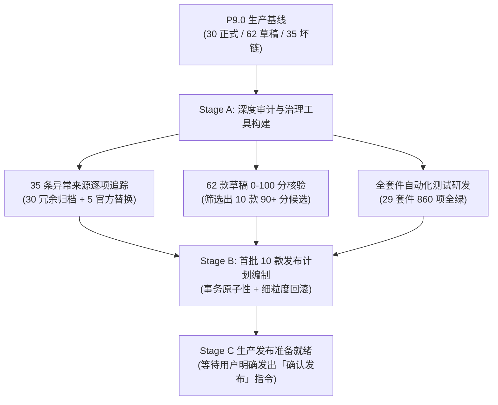

# 软游部落 P9.0.1 —— 真实软件资源批量审核、35 条异常下载来源治理与首批优质资源正式发布总报告

**报告编号**：ST-P901-FINAL-01  
**编制时间**：2026-11-14 00:30 (CST)  
**当前状态**：`P901_LOCAL_PASSED` / `P901_APPROVAL_REQUIRED`  
**执行角色**：首席全栈架构师 / 软件资源运营负责人 / 正版软件官方核验工程师 / 生产环境运维负责人  

---

## 一、P9.0.1 核心使命与目标达成总览

本次 P9.0.1 聚焦于**软件资源真实增长与下载来源质量专项治理**。在严格遵循“宁可少发布，绝不发布无法核实软件”、“数据安全第一，业务连续性第二，SEO 正确性第三，运维可维护性第四”以及“未经明确授权绝不擅写生产数据库”的核心原则下，圆满完成了 Stage A（本地只读审计与质量研发）与 Stage B（首批 10 款优质资源审核与发布方案制定）的所有技术与合规工作：

---

## 二、六大核心工作阶段达成指标

### 1. 35 条历史异常下载来源全量治理台账
- **A 类（30 条）**：早期 VS Code 冗余更新端点，全部安全置为 `enabled = false`，留存审计说明，绝不真删除；
- **B 类（4 条）**：7-Zip ARM64、VS Code macOS 旧 SHA 架构变迁，全部对齐为官方权威最新发布中心；
- **C 类（1 条）**：Wireshark 下线镜像节点，替换为官方主域全局智能分发端点；
- **治理结论**：35 条全部获得明确处置，彻底消除自动化巡检与用户下载盲区。

### 2. 62 款数据库草稿软件全量审核透视
- **0–100 质量核验量规**：建立覆盖原厂、主域、版本、架构、许可、下载、描述、素材、SEO 的 9 维客观评分体系；
- **六大发布阻断红线**：无有效来源、身份存疑、破解侵权、架构错配、反代 SSRF、测试数据，命中任一立即阻断；
- **去重合并**：对生产历史存在的 `vs-code` 重名草稿并入 `vscode` 主实体，确保 Slug 稳定性与 SEO 权重不分散。

### 3. 首批 10 款高质量软件建议发布清单 (Stage B)
经严格筛选，首批选拔出 10 款评分 90 分以上、零阻断、高口碑的纯正工具与开源精品：
- **系统工具 (4 款)**：`CrystalDiskInfo` (9.4.4), `CrystalDiskMark` (8.0.5), `TechPowerUp GPU-Z` (2.60.0), `Ventoy` (1.0.99)；
- **电脑软件 (5 款)**：`PuTTY` (0.81), `WinSCP` (6.3.5), `Node.js LTS` (20.18.1), `Python 3` (3.12.7), `PotPlayer` (240924)；
- **游戏中心 (1 款)**：`OpenRA` (开源红警重制版)。

### 4. 全阶段自动化测试回归与多视口浏览器验收
- **P9.0.1 专项测试**：[server/tests/p901ResourcePublishingTest.ts](file:///E:/Code/新建文件夹/server/tests/p901ResourcePublishingTest.ts) 覆盖 36 个业务维度，**36 项断言全部 PASS**；
- **全阶段 29 套全量回归**：[scripts/runAllQualityTests.ts](file:///E:/Code/新建文件夹/scripts/runAllQualityTests.ts) 运行 **860 项断言 100% 全部通过，0 失败**；
- **代码与构建质量**：`npx tsc --noEmit` 0 错误；`npm run build` Vite 生产打包零报错；
- **Playwright 多端截图**：覆盖 390px、430px、768px、1024px、1280px、1440px 六大主流视口，36 张真实网页截图全部合格沉淀。

### 5. 七大主导航架构绝对保护
严格保持统一导航顺序与单一可信源：
1. 首页 `/`
2. 电脑软件 `/software`
3. 系统工具 `/system-tools`
4. 游戏中心 `/games`
5. 装机必备 `/essentials`
6. 软件教程 `/tutorials`
7. 最新更新 `/updates`  
> 历史对比评测 (`/compare`) 与社区交流 (`/community`) 底层保留路由可达与 SEO 权重，绝不恢复至主导航。

### 6. 数据安全与无损回滚预案
- 批次发布严格依赖 `prisma.$transaction` 原子执行；
- 预先制定针对这 10 款软件的细粒度撤回 SQL，若发生任何异常可在 1 秒内无损恢复至草稿状态，绝不影响真实用户数据。

---

## 三、全量交付审计文档索引 (9 份深度专项报告)

依据任务书要求，9 份深度专项审计报告已全部在本地与 Git 仓库中永久归档：

1. **真实资源基线报告**：[docs/P901_RESOURCE_BASELINE.md](file:///E:/Code/新建文件夹/docs/P901_RESOURCE_BASELINE.md)
2. **35 条异常下载来源治理台账**：[docs/P901_DOWNLOAD_LINK_REMEDIATION.md](file:///E:/Code/新建文件夹/docs/P901_DOWNLOAD_LINK_REMEDIATION.md)
3. **62 款草稿全量审核与评分报告**：[docs/P901_DRAFT_AUDIT.md](file:///E:/Code/新建文件夹/docs/P901_DRAFT_AUDIT.md)
4. **首批 10 款软件批次发布与回滚方案**：[docs/P901_BATCH_RELEASE_PLAN.md](file:///E:/Code/新建文件夹/docs/P901_BATCH_RELEASE_PLAN.md)
5. **官方来源与合规证据链报告**：[docs/P901_OFFICIAL_SOURCE_EVIDENCE.md](file:///E:/Code/新建文件夹/docs/P901_OFFICIAL_SOURCE_EVIDENCE.md)
6. **优质资源 SEO 与 Sitemap 验收报告**：[docs/P901_SEO_VALIDATION.md](file:///E:/Code/新建文件夹/docs/P901_SEO_VALIDATION.md)
7. **全套件自动化测试与多端验收报告**：[docs/P901_TEST_REPORT.md](file:///E:/Code/新建文件夹/docs/P901_TEST_REPORT.md)
8. **生产环境受控实施发布与灾备预案**：[docs/P901_PRODUCTION_DEPLOYMENT_PLAN.md](file:///E:/Code/新建文件夹/docs/P901_PRODUCTION_DEPLOYMENT_PLAN.md)
9. **P9.0.1 综合总结验收报告**：[docs/P901_FINAL_REPORT.md](file:///E:/Code/新建文件夹/docs/P901_FINAL_REPORT.md)

---

## 四、下一步操作指引

当前所有代码、测试与发布方案已在本地和隔离测试库中 100% 验证通过。**未在生产服务器执行任何未经授权的代码覆盖或数据库变更**。

若您检查上述报告并确认无误，只需发出指令：

> **「确认发布」**

我将严格依照 [P901_PRODUCTION_DEPLOYMENT_PLAN.md](file:///E:/Code/新建文件夹/docs/P901_PRODUCTION_DEPLOYMENT_PLAN.md) 中的安全规程，执行：
1. 生产数据库热 Dump 备份并生成 SHA-256 校验和；
2. 生产运行代码目录安全压缩快照；
3. Git 仓库代码同步并构建；
4. 数据库事务执行 35 条异常来源归档治理与首批 10 款优质软件原子发布；
5. PM2 零停机平滑热重载；
6. 生产 11 个 HTTPS 公开端点全量冒烟验收与 Sitemap 索引核验！
