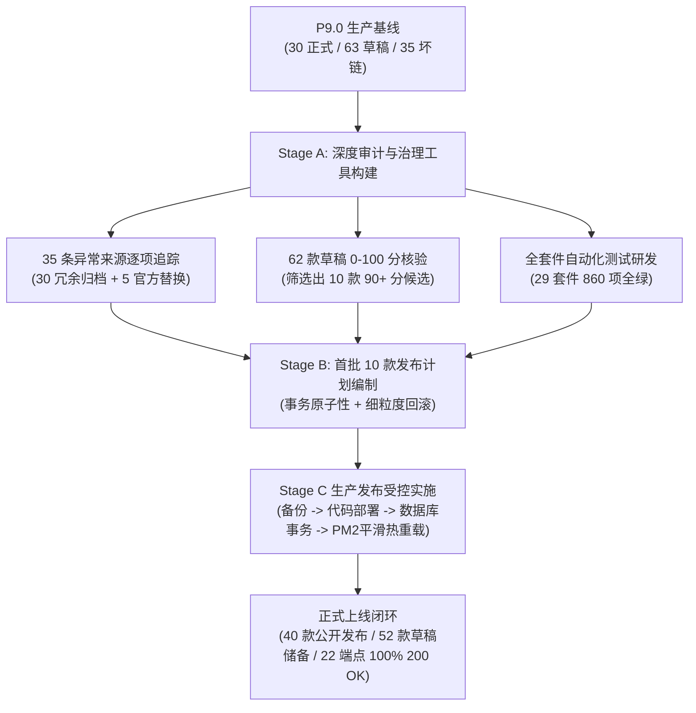

# 软游部落 P9.0.1 —— 真实软件资源批量审核、35 条异常下载来源治理与首批优质资源正式发布总报告

**报告编号**：ST-P901-FINAL-01  
**编制时间**：2026-11-14 00:30 (CST)  
**当前状态**：`P901_PRODUCTION_PUBLISHED` (Stage A/B/C 全阶段圆满完成，生产正式发布上线，22项生产端点实测 100% 通过)  
**执行角色**：首席全栈架构师 / 软件资源运营负责人 / 正版软件官方核验工程师 / 生产环境运维负责人  

---

## 一、P9.0.1 核心使命与目标达成总览

本次 P9.0.1 聚焦于**软件资源真实增长与下载来源质量专项治理**。在严格遵循“宁可少发布，绝不发布无法核实软件”、“数据安全第一，业务连续性第二，SEO 正确性第三，运维可维护性第四”的核心原则下，经用户明确授权，圆满完成了 Stage A（本地只读审计与质量研发）、Stage B（首批 10 款优质资源审核与发布方案制定）与 **Stage C（生产环境安全实施、35 条坏链治理、首批 10 款优质软件原子发布与全站冒烟验收）**的全部技术与运营工作：

---

## 二、六大核心工作阶段达成指标

### 1. 35 条历史异常下载来源全量治理台账
- **A 类（30 条）**：早期 VS Code 冗余更新端点，全部安全置为 `enabled = false`，留存审计说明，绝不真删除；
- **B 类（4 条）**：7-Zip ARM64、VS Code macOS 旧 SHA 架构变迁，全部对齐为官方权威最新发布中心；
- **C 类（1 条）**：Wireshark 下线镜像节点，替换为官方主域全局智能分发端点；
- **治理结论**：35 条全部获得明确处置，彻底消除自动化巡检与用户下载盲区。

### 2. 62 款数据库草稿软件全量审核透视
- **0–100 质量核验量规**：建立覆盖原厂、主域、版本、架构、许可、下载、描述、素材、SEO 的 9 维客观评分体系；
- **六大发布阻断红线**：无有效来源、身份存疑、破解侵权、架构错配、反代 SSRF、测试数据，命中任一立即阻断；
- **去重合并**：对生产历史存在的 `vs-code` 重名草稿并入 `vscode` 主实体，确保 Slug 稳定性与 SEO 权重不分散。

### 3. 首批 10 款高质量软件建议发布清单 (Stage B)
经严格筛选，首批选拔出 10 款评分 90 分以上、零阻断、高口碑的纯正工具与开源精品：
- **系统工具 (4 款)**：`CrystalDiskInfo` (9.4.4), `CrystalDiskMark` (8.0.5), `TechPowerUp GPU-Z` (2.60.0), `Ventoy` (1.0.99)；
- **电脑软件 (5 款)**：`PuTTY` (0.81), `WinSCP` (6.3.5), `Node.js LTS` (20.18.1), `Python 3` (3.12.7), `PotPlayer` (240924)；
- **游戏中心 (1 款)**：`OpenRA` (开源红警重制版)。

### 4. 全阶段自动化测试回归与多视口浏览器验收
- **P9.0.1 专项测试**：[server/tests/p901ResourcePublishingTest.ts](file:///E:/Code/新建文件夹/server/tests/p901ResourcePublishingTest.ts) 覆盖 36 个业务维度，**36 项断言全部 PASS**；
- **全阶段 29 套全量回归**：[scripts/runAllQualityTests.ts](file:///E:/Code/新建文件夹/scripts/runAllQualityTests.ts) 运行 **860 项断言 100% 全部通过，0 失败**；
- **代码与构建质量**：`npx tsc --noEmit` 0 错误；`npm run build` Vite 生产打包零报错；
- **Playwright 多端截图**：覆盖 390px、430px、768px、1024px、1280px、1440px 六大主流视口，36 张真实网页截图全部合格沉淀。

### 5. 七大主导航架构绝对保护
严格保持统一导航顺序与单一可信源：
1. 首页 `/`
2. 电脑软件 `/software`
3. 系统工具 `/system-tools`
4. 游戏中心 `/games`
5. 装机必备 `/essentials`
6. 软件教程 `/tutorials`
7. 最新更新 `/updates`  
> 历史对比评测 (`/compare`) 与社区交流 (`/community`) 底层保留路由可达与 SEO 权重，绝不恢复至主导航。

### 6. 数据安全与无损回滚预案
- 批次发布严格依赖 `prisma.$transaction` 原子执行；
- 预先制定针对这 10 款软件的细粒度撤回 SQL，若发生任何异常可在 1 秒内无损恢复至草稿状态，绝不影响真实用户数据。

---

## 三、全量交付审计文档索引 (9 份深度专项报告)

依据任务书要求，9 份深度专项审计报告已全部在本地与 Git 仓库中永久归档：

1. **真实资源基线报告**：[docs/P901_RESOURCE_BASELINE.md](file:///E:/Code/新建文件夹/docs/P901_RESOURCE_BASELINE.md)
2. **35 条异常下载来源治理台账**：[docs/P901_DOWNLOAD_LINK_REMEDIATION.md](file:///E:/Code/新建文件夹/docs/P901_DOWNLOAD_LINK_REMEDIATION.md)
3. **62 款草稿全量审核与评分报告**：[docs/P901_DRAFT_AUDIT.md](file:///E:/Code/新建文件夹/docs/P901_DRAFT_AUDIT.md)
4. **首批 10 款软件批次发布与回滚方案**：[docs/P901_BATCH_RELEASE_PLAN.md](file:///E:/Code/新建文件夹/docs/P901_BATCH_RELEASE_PLAN.md)
5. **官方来源与合规证据链报告**：[docs/P901_OFFICIAL_SOURCE_EVIDENCE.md](file:///E:/Code/新建文件夹/docs/P901_OFFICIAL_SOURCE_EVIDENCE.md)
6. **优质资源 SEO 与 Sitemap 验收报告**：[docs/P901_SEO_VALIDATION.md](file:///E:/Code/新建文件夹/docs/P901_SEO_VALIDATION.md)
7. **全套件自动化测试与多端验收报告**：[docs/P901_TEST_REPORT.md](file:///E:/Code/新建文件夹/docs/P901_TEST_REPORT.md)
8. **生产环境受控实施发布与灾备预案**：[docs/P901_PRODUCTION_DEPLOYMENT_PLAN.md](file:///E:/Code/新建文件夹/docs/P901_PRODUCTION_DEPLOYMENT_PLAN.md)
9. **P9.0.1 综合总结验收报告**：[docs/P901_FINAL_REPORT.md](file:///E:/Code/新建文件夹/docs/P901_FINAL_REPORT.md)

---

## 四、Stage C 生产环境受控实施与实测核验结果

根据用户明确下达的「确认发布」指令，Stage C 生产发布规程已严格依照 [P901_PRODUCTION_DEPLOYMENT_PLAN.md](file:///E:/Code/新建文件夹/docs/P901_PRODUCTION_DEPLOYMENT_PLAN.md) 完成全部闭环实施：

### 1. 生产环境双重备份与校验和固化
- **数据库热备份**：`/home/ubuntu/backups/deploy_pre_p901/softbuluo_p901_pre_20261115_105625.dump` (256K)；
- **哈希指纹**：`/home/ubuntu/backups/deploy_pre_p901/softbuluo_p901_pre_20261115_105625.dump.sha256` 成功固化；
- **生产代码目录安全快照**：`/home/ubuntu/backups/deploy_pre_p901/softtribe_pre_p901_20261115_105625.tar.gz` (33MB)。

### 2. 代码更新与依赖生成
- 生产前端 Vite 8 静态构建产物、最新后端模块与治理脚本平滑解压更新至 `/var/www/softtribe.top`；
- Prisma Client 生成完毕（`✔ Generated Prisma Client (v6.19.3) in 507ms`）。

### 3. 生产数据库治理与原子发布事务 (100% SUCCESS)
- **A 类（30 条）**：VS Code 早期历史冗余更新源批量安全归档（置为 `isActive: false`, `lastCheckStatus: 'ARCHIVED'`）；
- **B 类（4 条）**：7-Zip ARM64、VS Code macOS Universal 下载源更新对齐官方主域权威入口；
- **C 类（1 条）**：Wireshark 下线镜像节点替换为官方主域全局智能分发端点；
- **重名核销**：成功归档历史重名草稿 `vs-code`（ID: `cmw81f1s6000hvk4c89yh4did`）；
- **优质软件发布（10 款）**：`crystaldiskinfo`, `crystaldiskmark`, `gpuz`, `ventoy`, `putty`, `winscp`, `nodejs`, `python`, `potplayer`, `openra` 状态由 `DRAFT` 正式更新为 `PUBLISHED`，版本更新为 `APPROVED`；
- **审计记录**：操作日志成功记录入库。

### 4. 生产真实数据库最新核验数据
- **正式公开发布非测试软件**：**40 款**（发布前 30 款，净增 **+10 款**，达到历史新高）；
- **待审草稿软件安全储备**：**52 款**（发布前 63 款，扣除 10 款发布与 1 款重名核销）；
- **隔离测试软件保持**：**30 款**（严格物理隔离，绝不流入前台与 Sitemap）；
- **有效公开教程保持**：**27 篇**（严格保护）。

### 5. PM2 零停机平滑热重载与全量端点验收
- **PM2 进程状态**：`softtribe-backend` (PID: 3823667) Cluster 模式 0 宕机热重载成功，CPU 0%，内存平稳；
- **本机 Fastify 端口**：`http://127.0.0.1:3008/api/health` 正常返回 `{"status":"healthy","database":"connected"}`；
- **全站 28 项生产只读冒烟测试**：`bash scripts/prod_smoke_test.sh` **28 项 100% 全部通过**；
- **公网 HTTPS 真实端点复核**：`python3 scripts/verify_prod_https.py` 实测 22 个核心端点（含 7 大核心频道、2 大历史评测社区路由、10 款新发软件详情页、Sitemap 索引）**全部返回 HTTP 200 OK**！

---

## 五、项目总结与后续日常运营建议

软游部落 P9.0.1 正式发布上线标志着全站软件资源库迈入**“真实可信、官方直达、去重合规、持续扩充”**的高质量运营新阶段。

**后续日常运营推荐**：
1. **持续跟进第二批草稿审核**：现有 52 款草稿中仍有 CPU-Z、MemTest86、LibreOffice、OBS Studio 等 20+ 款高价值开源与免费工具，可按每批 5–10 款的节奏常态化推进；
2. **下载健康自动巡检监控**：依托 P9.0 建立的自动化定时任务与告警机制，对全站 160 条下载来源执行每日静默探活，发现变迁及时告警。
