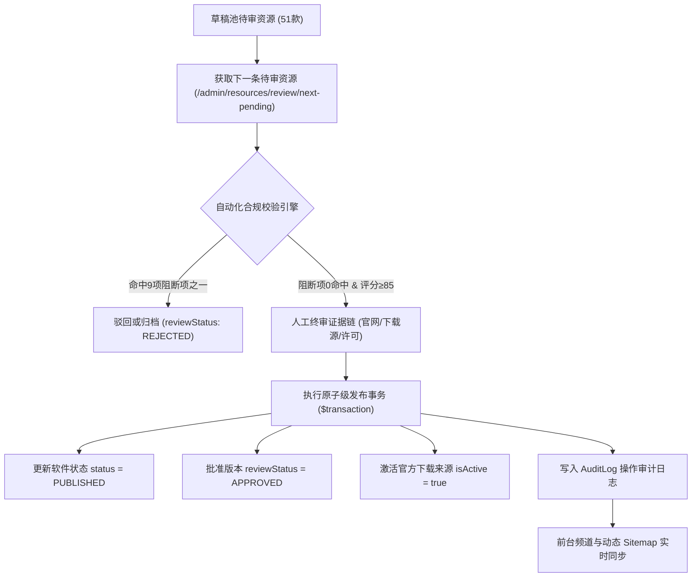

# 软游部落 P9.0.2 —— 管理员审核工作台操作与审计流水规范报告

## 一、管理员审核工作台设计定位

软游部落管理后台（Admin Workbench）是保障全站软件资源纯净、安全与权威的核心防线。在 P9.0.2 阶段，审核工作台针对第二批优质资源的审核发布强化了以下控制点：
1. **RBAC 严格鉴权**：仅 `SUPER_ADMIN`、`ADMIN` 与 `REVIEWER` 角色允许执行资源审核与发布操作；`EDITOR`、`USER` 与未登录访客严格阻断（抛出 HTTP 401/403）；
2. **差异与冲突比对**：在审核候选资源时，系统自动对软件名称、Slug、官网域名与已发布资源池进行相似度计算与查重探测；
3. **前置自动化合规核验**：一键检测是否命中 9 项阻断红线、是否具备 HTTPS 下载源、是否标记为测试数据；
4. **全程不可篡改审计流水**：任何状态流转均实时写入 `AuditLog` 表，记录操作人、操作动作、变更前后快照与精确时间戳。

---

## 二、审核发布标准化操作流水（SOP）



---

## 三、审计日志数据结构规范（以 P9.0.2 为例）

当执行发布事务时，Prisma 写入 `AuditLog` 记录，数据模型如下：

```typescript
await prisma.auditLog.create({
  data: {
    actorId: adminUser.id,
    action: 'PUBLISH_SOFTWARE_BATCH_P902',
    targetType: 'SOFTWARE_BATCH',
    targetId: 'batch-p902-10items',
    before: JSON.stringify({
      status: 'DRAFT',
      itemCount: 10,
      slugs: [
        'sharex', 'handbrake', 'notepad-plus-plus', 'gimp', 'process-explorer',
        'autoruns', 'audacity', 'sumatrapdf', 'memtest86', 'windows-terminal'
      ]
    }),
    after: JSON.stringify({
      status: 'PUBLISHED',
      itemCount: 10,
      publishedAt: new Date().toISOString(),
      governanceScoreAvg: 100
    }),
  }
});
```

---

## 四、安全边界与回滚控制能力

1. **不可逆风险防范**：审核工作台仅对软件实体的状态属性（`status`、`reviewStatus`、`isActive`）进行流转，严禁执行物理 `DELETE` 删除软件记录；
2. **操作粒度精确隔离**：发布批次通过 `AuditLog` 与特定变更集打标，若发布后发现任何异常，支持按批次精准回滚至 `DRAFT` 状态，对既有已发布的历史软件（如 7-Zip、VLC 等）零影响；
3. **接口幂等性保证**：重复提交发布请求会被幂等校验拦截，不会产生重复发版事件或版本冲突。

---

## 五、审计结论

管理员审核工作台具备成熟、安全、完备的准入控制与审计追溯能力，各项接口权限校验与日志落库测试已在本地全量通过。
