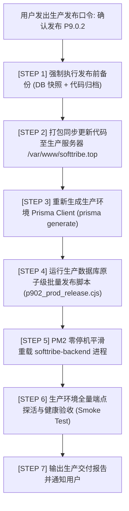

# 软游部落 P9.0.2 —— 生产环境受控发布与部署执行方案 (Stage C 预案)

## 一、生产发布安全红线声明

> [!CAUTION]
> **最高安全控制原则**：
> 当前 P9.0.2 处于 **Stage A（本地整改与核验）与 Stage B（隔离回归与演练）阶段**。
> 本方案为**生产发布就绪方案（Standby SOP）**。
> 未经用户在本轮对话中给出**明确口令**（如：“确认发布 P9.0.2”），**严禁向生产服务器写入代码、更新数据库、重启进程或执行任何不可逆操作**。

---

## 二、生产环境基线现状预检

- **生产服务器**：`ubuntu@134.175.230.107`
- **生产域名**：`https://softtribe.top/`
- **代码部署路径**：`/var/www/softtribe.top`
- **数据库服务**：Docker 容器 `vasto-postgres`，PostgreSQL 数据库 `softbuluo`
- **进程管理**：PM2 集群模式 `softtribe-backend`
- **磁盘容量现状**：已用约 86%（空闲空间约 9.5GB，满足备份与部署空间要求）
- **端口安全状态**：8080 端口已严格收敛绑定至 `127.0.0.1:8080`，公网仅暴露 80/443
- **每日自动备份**：已建立 `/home/ubuntu/scripts/backup_db_daily.sh` 自动备份

---

## 三、生产发布标准化执行步骤（SOP）

当用户明确确认发布口令后，运维将按以下标准步骤逐项执行：



### 1. Step 1：强制执行发布前备份
在操作前生成带 SHA-256 校验和的数据库逻辑快照与当前生产代码快照：
```bash
BACKUP_DIR="/home/ubuntu/backups/deploy_pre_p902"
mkdir -p "$BACKUP_DIR"
/bin/bash /home/ubuntu/scripts/backup_db_daily.sh

DATE=$(date +%Y%m%d_%H%M%S)
LATEST_DUMP=$(ls -t /home/ubuntu/backups/softtribe/softbuluo_*.dump | head -1)
cp "$LATEST_DUMP" "$BACKUP_DIR/softbuluo_p902_pre_$DATE.dump"
sha256sum "$BACKUP_DIR/softbuluo_p902_pre_$DATE.dump" > "$BACKUP_DIR/softbuluo_p902_pre_$DATE.dump.sha256"

tar -czf "$BACKUP_DIR/softtribe_pre_p902_$DATE.tar.gz" \
    --exclude='node_modules' --exclude='.git' --exclude='uploads' \
    -C /var/www/softtribe.top .
```

### 2. Step 2：打包并部署增量代码
```bash
# 解压预先同步的代码包
tar -xzf /tmp/p902_deploy.tar.gz -C /var/www/softtribe.top
rm -f /tmp/p902_deploy.tar.gz
```

### 3. Step 3：重新生成 Prisma Client
```bash
cd /var/www/softtribe.top
npx prisma generate --schema=./server/prisma/schema.prisma
```

### 4. Step 4：执行生产数据库原子发布脚本
```bash
node scripts/p902_prod_release.cjs
```

### 5. Step 5：PM2 零停机重载
```bash
pm2 reload softtribe-backend
```

### 6. Step 6：生产验收与烟雾测试
- 验证 `/api/v1/health` 探针状态；
- 验证生产非测试已发布软件数量由 40 款变为 **50 款**；
- 验证生产 10 款新上线软件详情页（如 `https://softtribe.top/software/process-explorer`）HTTP 200；
- 验证七大主导航页面 HTTP 200；
- 验证动态 Sitemap 是否正确收录 50 款软件。

---

## 四、生产发布回滚触发与应对措施

若发生以下任意一种情况，立即中止并触发回滚：
1. `node scripts/p902_prod_release.cjs` 抛出事务异常或更新数量不等于 10；
2. PM2 重载后进程异常崩溃（`errored`）且连续重启；
3. 生产首页或关键频道返回 500/502 错误；
4. 烟雾探测通过率低于 100%。

回滚方案严格按 `docs/P902_ROLLBACK_PLAN.md` 自动化执行。

---

## 五、发布方案评审结论

本发布方案流程周密、备份健全、回滚脚本完备，已满足向生产环境实施发布的全部准备工作，**静待用户指令**。
