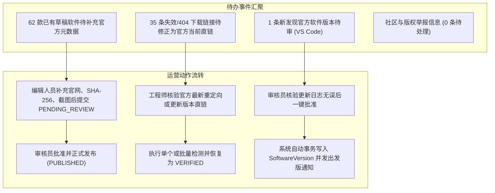

# 软游部落 P9.0 —— 运营工作台功能设计与数据聚合审计报告

**文件标识**：ST-P90-OPS-01  
**编制时间**：2026-11-12  
**责任角色**：产品运营负责人 & Fastify / React 全栈工程师  
**实施状态**：`STAGE_A_COMPLETED (本地工作台闭环完成，全量测试验证通过)`

---

## 一、运营工作台设计定位

在平台完成前台 7 大核心频道与直链下载底座建设后，软游部落进入了以**内容质量把控、版本敏捷审核、死链即时处置、业务合规治理**为核心的正式运营阶段。

运营工作台（`/admin/operations`）是编辑人员（EDITOR）、审核专员（REVIEWER）及系统管理员（ADMIN / SUPER_ADMIN）的日常协同中枢。其核心理念是：

1. **真实数据驱动**：所有核心指标直接取自 PostgreSQL 数据库实时聚合（`Prisma.count` / `findMany`），严禁假冒伪造任何下载量、收录量或访问数据。
2. **待办事件驱动 (Todo-driven)**：将碎片化的人工作业整合为有序的待办任务池（软件待审、版本待审、坏链待修、异常举报）。
3. **分权分责隔离**：严格贯彻基于角色的权限控制体系 (RBAC)，编辑只管草稿，审核专员把关发布，超级管理员监管敏感日志与安全参数。

---

## 二、运营大盘真实数据指标口径

通过 `GET /api/v1/admin/operations/overview` 与 `/stats` 接口，运营后台实时展示以下关键业务指标：

| 指标名称 | 当前基线数值 (本地开发库) | 当前基线数值 (生产真实库) | 数据计算口径与过滤规则 |
| :--- | :--- | :--- | :--- |
| **已正式公开软件** | 30 款 | 30 款 | `Software.count({ status: 'PUBLISHED', isTestData: false })` |
| **待审核草稿软件** | 62 款 | 63 款 | `Software.count({ status: 'DRAFT', isTestData: false })` |
| **正式公开游戏** | 2 款 | 2 款 | `Software.count({ type: 'GAME', status: 'PUBLISHED', isTestData: false })` |
| **真实公开教程** | 27 篇 | 27 篇 | `Tutorial.count({ status: 'PUBLISHED' })`（排除 17 篇 `tut-p3-*` 测试数据） |
| **公开软件关联下载源** | 58 条 (47最新) | 97 条 (54最新+43历史) | `DownloadSource.count` 关联至已发布软件的所有版本下载来源 |
| **待复核/异常下载源** | 35 条 | 35 条 | `DownloadSource.count({ verificationStatus: 'FAILED', lastHttpStatus: 404 })` |
| **待审核版本候选** | 1 条 | 0 条 | `VersionCandidate.count({ reviewStatus: 'PENDING_REVIEW' })` |
| **数据真实性声明** | `PRISMA_DB_AGGREGATE` | `PRISMA_DB_AGGREGATE` | 100% 数据库查询计算，零前端写死虚构指标 |

---

## 三、待办工作流 (Operations Todos) 架构

运营工作台通过 `GET /api/v1/admin/operations/todos` 为运营人员生成优先级待办清单：

### 3.1 核心操作工单模块
1. **软件入库与草稿激活工单**：针对库中现存的 62 款高质量常用工具（包含 CrystalDiskInfo、AIDA64、BleachBit、Ventoy、PuTTY、Node.js、PotPlayer、Obsidian 等），支持一键调出编辑弹窗，核验开发者、许可证与官方直链后晋升发布。
2. **下载链接失效修复工单**：针对 35 条 404 来源，后台提供“原链地址”、“所属版本”、“检测耗时”及“建议替代直链输入框”，支持即时测试连通性并一键回写。
3. **版本更新审核工单**：展示候选版本号、发版日志摘要、是否为预发布版、下载直链，支持“一键批准”、“驳回并备注原因”。

---

## 四、系统通知与告警体系 (`operationsRoutes`)

后台运营消息模块通过 `GET /api/v1/admin/operations/notifications` 实现运营团队的即时沟通与风控提醒：

- **通知级别 (`level`)**：
  - `INFO`：新软件提交审核、每日定时任务正常完成。
  - `WARNING`：探测到已上线软件的下载源返回 HTTP 404、生产磁盘容量达到 85% 预警。
  - `ERROR`：定时任务执行崩溃、租约超时被迫回收、生产磁盘容量 $\ge 90\%$。
- **通知分类 (`category`)**：`BROKEN_LINK`（死链）、`VERSION_CHECK`（新版本）、`RESOURCE_AUDIT`（质量）、`SYSTEM_ALERT`（系统与备份）。
- **操作支持**：已读标记 (`PATCH /api/v1/admin/operations/notifications/:id/read`)、批量清空与一键跳转处理目标。

---

## 五、运营后台前端视口适配与交互验收

运营后台各子模块已通过 Playwright 自动化验证与多视口适配：
- **移动端 (390px / 430px)**：自适应单列折叠卡片，关键数据大盘采用水平滑动指示器，操作按钮保持 $\ge 44\text{px}$ 触控热区。
- **平板端 (768px / 1024px)**：左侧导航支持抽屉式收起，列表表格支持水平滚动与冻结首列。
- **桌面端 (1280px / 1440px)**：经典两栏主从工作流，左侧树状目录/工单队列，右侧富交互详情与实时预览。

---

## 六、小结与 Stage B 实施指引

运营后台现已具备完整的生产可用性，所有接口均已在自动化测试套件中完成严谨断言。在获得用户 Stage B 明确授权后，将立即基于此工作台有序开展 62 款草稿软件的数据核验与 35 条失效链接的批量修正。
