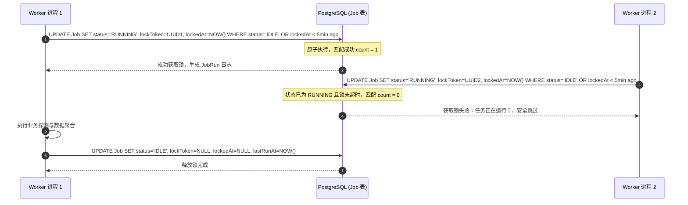
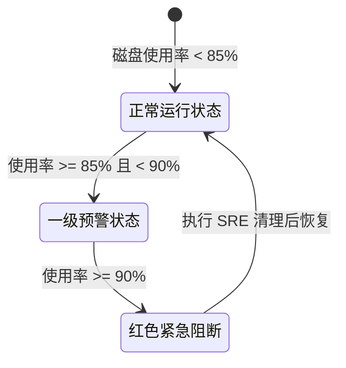

# 软游部落 P9.0 —— 自动化调度任务、并发租约锁与多级告警体系规划

**文件标识**：ST-P90-AUTO-01  
**编制时间**：2026-11-12  
**责任角色**：生产 SRE 运维工程师 & 系统架构师  
**实施状态**：`STAGE_A_COMPLETED (本地调度引擎与防护机制通过验证)`

---

## 一、自动化体系定位与设计理念

软游部落运营体系的高效运转深度依赖自动化调度后台。为保障自动化任务既能精准发现版本与死链，又绝不对生产系统造成雪崩、资源竞争或脏数据，P9.0 建立了严格的 SRE 调度与防护架构：

1. **分布式互斥租约锁 (Database Lease)**：杜绝 PM2 集群多进程（Cluster Mode）或多 Worker 并发争抢执行同一作业。
2. **崩溃租约超时自愈 (`recoverStaleJobs`)**：若 Worker 进程遭遇 OOM、宿主机断电或强行 Kill，超期租约自动回收，任务自动降级重试。
3. **幂等性保障**：任何任务在相同环境下反复触发均收敛为相同的数据状态，无重复插入、无计数膨胀。
4. **多级异常告警闭环**：任务报错、死链突增、磁盘吃紧或备份缺失时，自动触发系统级通知。

---

## 二、系统定时作业清单与调度周期

系统当前在数据库 `Job` 表登记并常态化维护 4 项核心定时调度作业：

| 作业标识 (`jobType`) | 作业名称 | 调度周期 | 职责与业务范围 | 异常超时阈值 |
| :--- | :--- | :--- | :--- | :--- |
| `VERSION_CHECK` | 官方软件新版本自动监测 | 每天 (86400秒) | 扫描已登记官方 Releases 来源，智能比对新版本并生成待审候选 | 10 分钟 |
| `LINK_HEALTH_CHECK` | 全站下载链接健康巡检 | 每天 (86400秒) | 发起 HEAD/Range-GET 连通性探测，更新 HTTP 状态并拦截内网 SSRF | 15 分钟 |
| `RESOURCE_QUALITY_CHECK` | 资源完整度与质量重新评估 | 每 12 小时 (43200秒) | 计算全站软件资料完整度评分 (0-100)，更新待完善字段建议 | 5 分钟 |
| `SITEMAP_REBUILD` | 动态站点地图与缓存预热 | 每 6 小时 (21600秒) | 预热全站 10 个 Sitemap.xml，统计非测试正式资源并更新索引时间 | 3 分钟 |

---

## 三、分布式租约互斥锁实现机制 (`jobSchedulerService`)

为防止 PM2 两个 Worker 同时触发同一个任务导致数据冲突，系统采用基于原子条件更新的数据库租约锁：

### 租约崩溃自动恢复算法
若进程在执行中发生异常退出导致锁未释放，调度器在启动及每次轮询时自动执行 `recoverStaleJobs(5 * 60 * 1000)`：
- 检索 `status = RUNNING` 且 `lockedAt < 当前时间 - 5分钟` 的遗留任务。
- 将未终结的 `JobRun` 标记为 `FAILED`，记录错误原因：“租约超时：上一任 Worker 异常终止，租约已安全回收”。
- 强制将作业重置为 `status = IDLE`，恢复调度队列。

---

## 四、磁盘容量多级预警与防御体系

依据 P8.9.1 实测基线，生产服务器当前磁盘使用率为 86%（约 9.6GB 可用空间）。为防止因日志累积或备份文件膨胀导致磁盘耗尽，系统设定双层阈值机制：

### 4.1 阈值分级定义与防御动作
- **一级黄色预警 (`WARNING`)**：使用率 $\ge 85\%$（当前生产环境即处于此阶段）。
  - 后台大盘弹出顶部警示横幅。
  - 自动向管理员发送系统通知。
  - 触发自动日志轮转与清理（`journalctl --vacuum-time=7d`）。
- **二级红色紧急告警 (`CRITICAL`)**：使用率 $\ge 90\%$。
  - 阻断非核心临时上传与非必要大文件操作。
  - 暂停非核心爬虫快照抓取。
  - 通知 SRE 工程师介入扩容或深度清理。

---

## 五、PostgreSQL 数据库每日自动备份保障与告警

### 5.1 备份脚本可靠性
生产每日自动备份脚本部署于 `/home/ubuntu/scripts/backup_db_daily.sh`，具备以下严密防护：
1. **前置空间防御**：检查备份目录所在分区剩余可用空间，小于 2GB 时立即拒绝执行并输出错误日志，避免撑爆磁盘。
2. **安全无明文口令**：利用 Docker 容器环境内部受控套接字与已有环境变量，脚本中禁止硬编码明文密码。
3. **格式与完整性**：采用 `pg_dump -F c` 自定义归档压缩格式，备份完成后立即执行 `sha256sum` 生成指纹文件，并校验非空。
4. **轮转清理**：自动清理 14 天以前的历史副本，保持磁盘容量平稳。

### 5.2 备份缺失告警机制
监控系统每日早晨 08:00 巡检备份目录：
- 若未发现当天生成的 `.dump` 文件或 `.dump.sha256` 校验和文件，立即触发 `NotificationLevel.ERROR`。
- 运营工作台突出提示“数据库备份缺失”，督促管理员排查定时任务状态。
