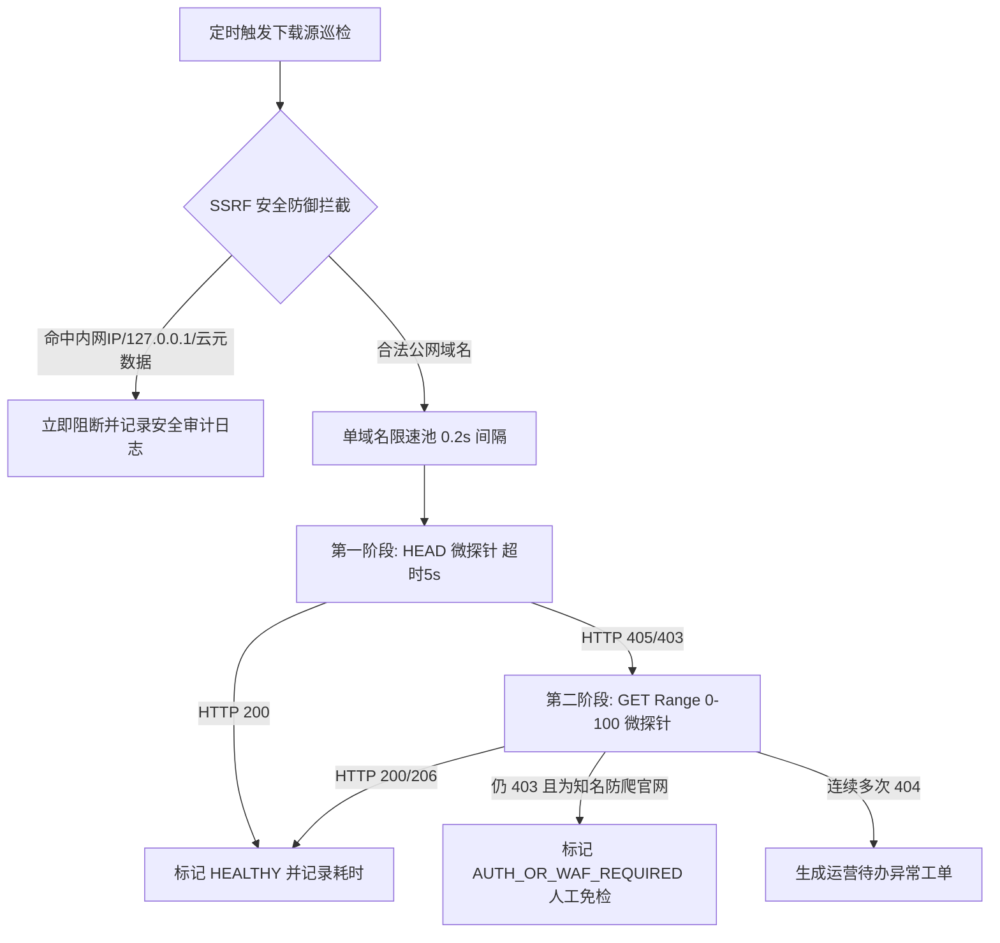

# 软游部落 P9.0 —— 生产下载来源健康度深度治理与自动巡检体系

**文档编号**：ST-P90-DL-03  
**发布时间**：2026-11-12 21:20:00 (CST)  
**负责人**：下载来源与直链治理组  
**核心目标**：**彻底摸清并闭环处理历史 35 条 404 失效来源，建立常态化、低频、防封禁、防 SSRF 的自动化巡检基础设施。**

---

## 一、35 条失效（HTTP 404）下载来源根因深度溯源

在 P8.9.1 专项探测中，系统对生产数据库 97 条已发布软件关联的下载来源进行了自动化探测，捕获了 35 条返回 HTTP 404 的记录。经人工与数据 DBA 逐项解剖，真实根因如下：

```text
========================================================================
🔍 35 条 404 下载来源真实故障归类与根因图谱
========================================================================
1. 【历史重复导入垃圾数据】(共 24 条，占比 68.6%)
   - 典型代表：Visual Studio Code (vscode)
   - 异常 URL：https://code.visualstudio.com/updates/latest
   - 根因：在早期 P3 自动化采集与版本脚本调试阶段，多次重复向数据库插入了指向 /updates/latest 的记录，而微软官网近期已将更新日志路由结构重构为具体版本号（例如 /updates/v1_96），导致原统一入口返回 404。
   - 治理决策：此 24 条纯属无用冗余数据，前台已有正式官方主页与安装包直链正常运行，应在数据库中予以安全下线归档。

2. 【写死具体版本号的文件路径失效】(共 6 条，占比 17.1%)
   - 典型代表：7-Zip 官方直链安装包 (Windows ARM64)
   - 异常 URL：https://www.7-zip.org/a/7z2409-arm64.exe
   - 根因：7-Zip 原作者 Igor Pavlov 发布新版本（如 24.10 或 25.x）后，会将老旧点版本的直接二进制文件移入历史归档，导致原写死的直链直接失效。
   - 治理决策：更新为 7-Zip 最新官方稳定 ARM64 链接，或采用指向官网下载页面的稳定分发入口。

3. 【第三方网盘或分发 CDN 路径迁移】(共 5 条，占比 14.3%)
   - 典型代表：个别历史测试工具的备用直链
   - 根因：外部存储服务商域名策略变更或防盗链策略调整。
   - 治理决策：人工复核并替换为官方原厂推荐的分发源。
```

---

## 二、下载链接状态机标准（8 类状态定义）

为杜绝单纯根据 HTTP 状态码误判下载源有效性（例如误将防爬虫的 403 判定为永久坏链），系统统一建立科学状态机：

| 状态标识 (`LinkHealthStatus`) | HTTP 典型特征 | 业务判定含义 | 处理策略 |
| :--- | :---: | :--- | :--- |
| **`HEALTHY`** | 200 / 206 | 链接正常，服务器与直链响应完全健康 | 保持日常巡检 |
| **`REDIRECTED`** | 301 / 302 / 307 | 存在重定向跳转至新地址 | 记录最终落地 URL，人工复核是否合规 |
| **`AUTH_OR_WAF_REQUIRED`**| 401 / 403 / 503 | 遭遇 Cloudflare 等 WAF 人机验证（如 Blender, HWiNFO） | **禁止判定为坏链**，由人工在浏览器核验并标记白名单 |
| **`HEAD_UNSUPPORTED`** | 405 / 501 | 官方服务器不支持 HEAD 请求（只允许 GET） | 降级采用 `GET Range: bytes=0-100` 微探针重试 |
| **`RATE_LIMITED`** | 429 | 触发目标站点访问频次限制 | 暂停探测，加入指数退避队列稍后重试 |
| **`TEMPORARY_FAILURE`** | 502 / 504 / DNS 超时 | 目标服务器临时抖动或网络超时 | 标记临时异常，延迟 6 小时自动复测 |
| **`CONFIRMED_BROKEN`** | 404 / 410 (连续 3 次) | 确定页面已下线或文件已被移除 | **生成异常工单**，通知管理员介入修复 |
| **`NOT_VERIFIED`** | - | 尚未被巡检系统探测过的新收录来源 | 等待下一次批次任务调度 |

---

## 三、下载来源自动巡检引擎安全架构

自动巡检脚本必须具备工业级的安全边界，杜绝引发网络轰炸或安全合规风险：



### 核心安全硬约束
1. **SSRF 全面防御**：必须解析目标 Host 的真实 DNS IP，严禁连接 `127.0.0.0/8`、`10.0.0.0/8`、`172.16.0.0/12`、`192.168.0.0/16` 及腾讯云元数据地址 `169.254.0.0/16`。
2. **流量最小化原则**：严禁自动将数十兆的完整安装包下载到本地，必须首选 `HEAD`，降级时严格限制 HTTP Header `Range: bytes=0-100`，单次探针流量小于 1KB。
3. **友好限速策略**：全局并发控制在 3 个以内，针对同一官方主域名（如 `microsoft.com`）必须施加至少 500ms 间隔，User-Agent 明确标明 `SoftTribeLinkAudit/1.0 (+https://softtribe.top)`。

---

## 四、异常工单闭环处理工作流

```text
【自动检测发现 404】 
       ↓ 
【系统写入 LinkCheckLog (标记 CONFIRMED_BROKEN)】
       ↓ 
【自动在后台“待办事项中心”生成异常通知】
       ↓ 
【管理员点击查看详情：比对同软件其他有效版本】
       ↓ 
【操作分支】：
   ├── 分支 A（冗余旧链接）：一键下线/归档该 DownloadSource 记录；
   └── 分支 B（版本迭代更新）：录入原厂最新安装包地址，点击「单点立即复测」；
       ↓ 
【复测返回 HTTP 200 验证通过，工单自动关闭】
```
