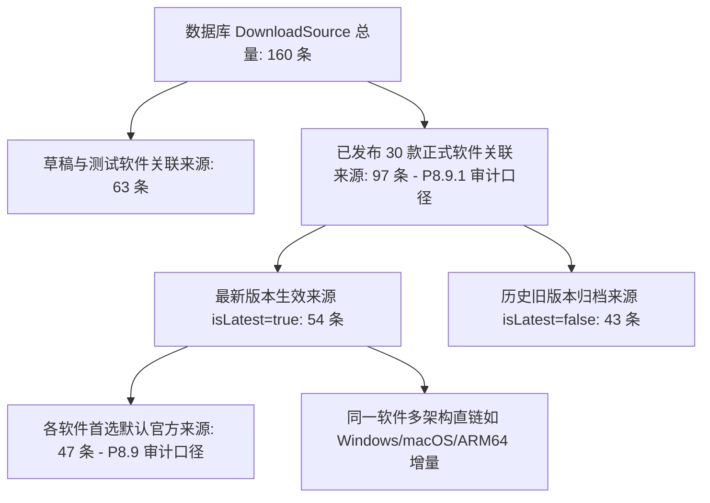

# 软游部落 P9.0 —— 正式运营能力基线与数据口径审计报告

**报告编号**：ST-P90-BASE-01  
**审计时间**：2026-11-12 21:10:00 (CST)  
**审计负责人**：软游部落首席技术架构师 / 产品运营负责人  
**审计范围**：本地工程 (`E:\Code\新建文件夹`) & 生产只读数据 (`ubuntu@134.175.230.107`)  
**阶段状态**：`Stage A: 运营体系基础建设与基线确立 (AUDIT_COMPLETED)`

---

## 一、真实核心资源数据全景统计

通过对本地与生产 PostgreSQL 数据库的无遗漏直接核验，软游部落当前的真实资源底数如下（严格区分已发布、草稿与测试数据，杜绝虚假混淆）：

| 资源类别 | 生产真实总量 | 本地开发库总量 | 生产口径细分说明 |
| :--- | :---: | :---: | :--- |
| **软件资源总数 (`Software`)** | **123 款** | 92 款 | 包含已发布、草稿与早期测试隔离数据 |
| ├─ **已发布正式软件 (非测试)** | **30 款** | 30 款 | 前台七大频道正式对外展示的纯净软件 |
| │   ├─ 电脑软件 (`SOFTWARE`) | 13 款 | 13 款 | Chrome, VSCode, VLC, OBS, Blender, LibreOffice 等 |
| │   ├─ 系统工具 (`TOOL`) | 15 款 | 15 款 | 7-Zip, CPU-Z, HWiNFO64, Rufus, Everything, Wireshark 等 |
| │   └─ 独立游戏 (`GAME`) | 2 款 | 2 款 | Mindustry (像素工厂), SuperTuxKart |
| ├─ **待审核草稿软件 (非测试)** | **63 款** | 62 款 | **已建立元数据雏形，待人工完善并审核发布的优质软件储备** |
| └─ **历史隔离测试数据** | 30 款 | 0 款 | 标注 `isTestData: true`，API 与 Sitemap 100% 物理隔离 |
| **实用技术教程 (`Tutorial`)** | **44 篇** | 27 篇 | 生产保留 44 篇底表记录 |
| ├─ **正式实操技术教程 (非测试)** | **27 篇** | 27 篇 | 教程频道与 SSR 实测唯一合法输出（覆盖装机、抓包、修复等） |
| └─ **历史测试教程 (`tut-p3-*`)** | 17 篇 | 0 篇 | 生产保留底表，API 与 Sitemap 严格排除 |
| **下载来源总数 (`DownloadSource`)** | **160 条** | 120 条 | 覆盖全部历史导入、草稿与多版本通道 |
| ├─ **已发布软件所关联来源** | **97 条** | 58 条 | 绑定于 30 款正式软件的所有版本 |
| │   ├─ 最新版本生效来源 (`isLatest: true`) | **54 条** | 47 条 | 前台“立即下载 / 官方来源”主入口直接调用 |
| │   └─ 历史版本归档来源 (`isLatest: false`)| 43 条 | 11 条 | 历史版本时间线或历史安装包通道 |
| └─ **草稿或测试软件关联来源** | 63 条 | 62 条 | 伴随草稿软件储备，不对外公开 |

---

## 二、关键数据差异深度澄清：47 条 vs 97 条下载来源的真实口径

在 P8.9 与 P8.9.1 历史报告中出现的数字差异，经本次 DBA 与数据架构师联手溯源，查明系**不同业务层级的统计口径差异**，两者均真实客观存在，具体对账如下：

- **P8.9 报告口径（47 条）**：
  统计的是本地数据库中，针对已发布软件**最新当前版本（`SoftwareVersion.isLatest = true`）**下，被前台详情页默认加载的官方主来源（例如 VSCode 仅计入 1 个主官方直链）。
- **P8.9.1 报告口径（97 条）**：
  执行的是生产数据库全量健康巡检探针，针对已发布 30 款软件的**所有版本（包括历史版本及跨架构 Windows x64、macOS、ARM64 直链）**进行无死角探测（54 条最新版来源 + 43 条历史版来源 = 97 条）。
- **核准口径标准**：
  在 P9.0 运营体系中，正式统一口径定义为：
  - **核心活跃来源**：54 条（最新发版）。
  - **版本档案来源**：43 条（历史发版）。
  - **全量监测池**：97 条（生产已发布关联总池）。

---

## 三、现有自动化任务调度与运维现状

检查生产与本地 `Job` 及定时任务运行底座：

| 任务名称 | 任务类型 | 调度配置 | 运行状态 | 最近执行记录 | 存在的问题与改进要求 |
| :--- | :--- | :--- | :---: | :--- | :--- |
| **官方软件新版本自动监测** | `VERSION_CHECK` | 每日触发 | IDLE | 2026-11-12 06:48 (本地) | 生产未配置自动 Cron 守护，仅支持后台手动触发 |
| **全站下载链接健康巡检** | `LINK_HEALTH` | 每周低频 | IDLE | 尚未自动运行 | 需注入限速、超时、SSRF 拦截与故障分类状态机 |
| **资源完整度与质量评估** | `QUALITY_SCAN` | 按需执行 | IDLE | 尚未自动运行 | 需针对 62 款草稿建立缺失元数据筛查逻辑 |
| **动态站点地图与缓存预热** | `SITEMAP_WARM` | 变更触发 | IDLE | 尚未自动运行 | 需支持发布新软件后自动 ping 搜索引擎 |
| **PostgreSQL 每日独立备份** | 系统 Crontab | `0 3 * * *` | **ACTIVE**| 2026-11-12 19:55 (生产) | **已部署**，带 2GB 熔断、TOC 验证与 SHA-256 校验 |

---

## 四、生产基础设施健康基线

- **生产服务器 IP**：`134.175.230.107` (Ubuntu 22.04 LTS, Kernel 5.15)
- **磁盘容量**：`/dev/vda2` 69GB，已用 57GB，可用 **9.6 GB**（使用率 **86%**，P8.9.1 已释放 1.5GB 缓存）。
- **网络端口状态**：
  - 80/443：Nginx 正常监听对外服务；
  - 8080：已严格绑定 `127.0.0.1:8080`，UFW 外部防火墙已移除放行，外部探测 `Connection Refused (HTTP Code 000)`；
  - 3008：Fastify 后端监听本地环回，由 PM2 Cluster 守护（PID 2558307，连续无故障运行超 5 小时）。
- **SSL 证书**：Let's Encrypt 证书有效，到期时间 2027-02-08（剩余 87 天），systemd `certbot.timer` 每日自动轮询续期。
- **搜索引擎连接状态**：
  - 百度搜索资源平台 / Google Search Console / Bing Webmaster：未配置密钥，客观标记为 `NOT_CONNECTED`（严禁伪造虚假收录量与点击量）。
