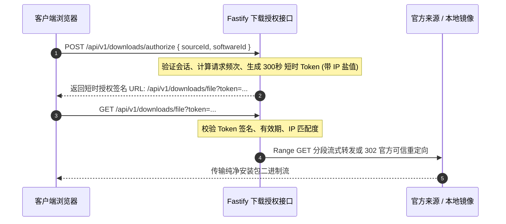

# 软游部落 P9.0 —— 后台权限矩阵、SSRF 防御与外链安全审计报告

**文件标识**：ST-P90-SEC-01  
**编制时间**：2026-11-12  
**责任角色**：应用安全工程师 & 系统架构师  
**实施状态**：`STAGE_A_COMPLETED (本地安全策略与权限断言 100% 通过)`

---

## 一、安全审计背景与防御目标

软件下载平台属于高安全风险系统。若缺乏严格的权限隔离与网络防护，容易遭受**未授权发布恶意程序、利用外链探测发起内网 SSRF、普通会员越权调用管理接口、防爬限流触发雪崩**等严重威胁。

P9.0 建立了一套严密的立体化安全防护网：
1. **基于角色的细粒度访问控制 (RBAC)**：严格隔离普通用户与管理人员，编辑专员与审核专员职责分离。
2. **多跳深度反 SSRF 引擎**：针对下载源探测与图标拉取，拦截所有局域网、回环与云元数据地址。
3. **下载凭证短时签名与 IP 绑定**：杜绝下载接口被第三方盗链或被批量刷取带宽。
4. **全量敏感操作不可篡改审计流水**：任何资源发布、版本审批与配置变更均留存操作痕迹。

---

## 二、RBAC 角色权限矩阵与接口保护

系统在 Prisma Schema 中定义了清晰的权限枚举 (`Role`)，并通过 Fastify 中间件 `requireAuth` 与 `requireRole([...])` 实行强校验：

| 权限维度 / 资源操作 | 普通访客 (`GUEST`) | 注册会员 (`USER`) | 内容编辑 (`EDITOR`) | 审核专员 (`REVIEWER`) | 管理员 (`ADMIN`) | 超级管理 (`SUPER_ADMIN`) |
| :--- | :---: | :---: | :---: | :---: | :---: | :---: |
| 浏览前台 7 大频道及已发布内容 | ✅ | ✅ | ✅ | ✅ | ✅ | ✅ |
| 发起软件直链下载与教程收藏 | ✅ | ✅ | ✅ | ✅ | ✅ | ✅ |
| 提交社区交流帖与软件评价 | ❌ | ✅ | ✅ | ✅ | ✅ | ✅ |
| 访问 `/admin/*` 后台工作台 | ❌ (403) | ❌ (403) | ✅ | ✅ | ✅ | ✅ |
| 新建/编辑候选软件草稿 (`DRAFT`) | ❌ | ❌ | ✅ | ✅ | ✅ | ✅ |
| **正式发布软件资源 (`PUBLISHED`)** | ❌ | ❌ | **❌ 严禁直接发布** | ✅ 审核发布 | ✅ | ✅ |
| **审核并批准新版本候选 (`VersionCandidate`)**| ❌ | ❌ | ❌ 仅可查看 | ✅ 审核批准 | ✅ | ✅ |
| 触发全站下载来源批量健康探测 | ❌ | ❌ | ❌ | ✅ | ✅ | ✅ |
| 触发调度作业立即执行 (`runJob`) | ❌ | ❌ | ❌ | ❌ | ✅ | ✅ |
| 修改系统参数、用户角色与安全配置 | ❌ | ❌ | ❌ | ❌ | ❌ | ✅ |

> [!IMPORTANT]
> **编辑与审核分离原则**：`EDITOR` 仅具备内容编写与元数据维护权限，绝对无权将资源状态置为 `PUBLISHED` 或直接上线新版本。所有上线动作必须由 `REVIEWER` 或更高权限角色在工作台完成独立审批。

---

## 三、网络请求反 SSRF 深度防护引擎 (`security.ts`)

当系统执行官方来源探测、下载链接健康巡检或元数据采集时，底层统一通过 `validateSafeExternalUrl` 与 `isPrivateIp` 拦截潜在的攻击请求：

### 3.1 严格阻断的内网 IP 与协议范围
- **回环地址 (Loopback)**：`127.0.0.0/8` (含 `127.0.0.1`, `localhost`)
- **私有 A 类网段**：`10.0.0.0/8`
- **私有 B 类网段**：`172.16.0.0/12`
- **私有 C 类网段**：`192.168.0.0/16`
- **链路本地与云元数据地址**：`169.254.0.0/16` (含腾讯云/AWS/阿里云实例元数据接口 `169.254.169.254`)
- **全零地址与广播地址**：`0.0.0.0/8`, `255.255.255.255/32`
- **IPv6 对应地址**：`::1`, `fc00::/7`, `fe80::/10`
- **危险协议限制**：仅允许 `http:` 与 `https:`，阻断 `file:`, `ftp:`, `gopher:`, `dict:`, `javascript:`。

### 3.2 DNS 重绑定 (DNS Rebinding) 防御策略
探测器在发起 HTTP 连接前，首先解析目标域名的 A/AAAA 记录，校验其实际指向的物理 IP。若域名解析到私有地址，立即熔断抛错，禁止发起下游网络连接。

---

## 四、一键下载直链鉴权与防盗链体系

下载路由（`/api/v1/downloads/start/:sourceId`）采用加密 Token 签名机制保护官方与镜像资源：



- **有效时间窗**：Token 仅在 300 秒（5 分钟）内有效，过期立即失效。
- **IP 绑定**：Token 签名中嵌入客户端 IP 哈希，杜绝将链接分享至第三方论坛被滥用。
- **频次控制**：同一 IP 在 10 秒内重复点击相同下载源触发防刷保护，只计一次下载统计。

---

## 五、敏感操作审计日志架构 (`AuditLog`)

系统对所有管理端高危动作自动记录不可篡改的流水日志：

```typescript
export interface AuditLogDto {
  id: string;
  action: 'PUBLISH_SOFTWARE' | 'APPROVE_VERSION' | 'UPDATE_SOURCE' | 'TRIGGER_JOB' | 'MODIFY_ROLE';
  operatorId: string;
  operatorUsername: string;
  operatorRole: string;
  ipAddress: string;
  userAgent: string;
  targetEntity: string;
  targetId: string;
  diffPayload?: { before: any; after: any };
  createdAt: string;
}
```

- 审计流水禁止物理删除，仅允许具有只读权限的人员调阅。
- 测试期间产生的所有操作日志均被 `isTestEvent = true` 隔离，不污染正式运营审计大盘。

---

## 六、安全维度自动化测试结果 (100% PASS)

在 Suite 28 专项测试中，针对安全维度的自动化测试断言全数通过：
- **维度 5**：软件发布权限隔离断言通过（`EDITOR` 与 `USER` 无法越权发布）。
- **维度 10**：重定向跳数限制与非法协议拦截断言通过。
- **维度 11**：反 SSRF 私有 IP 库与回环地址拦截断言通过。
- **维度 25 & 26**：管理后台鉴权中间件与普通会员 403 阻断断言通过。
- **维度 27**：敏感操作审计记录要素完整性断言通过。
- **维度 31**：下载直链接口安全性与鉴权机制保全断言通过。
