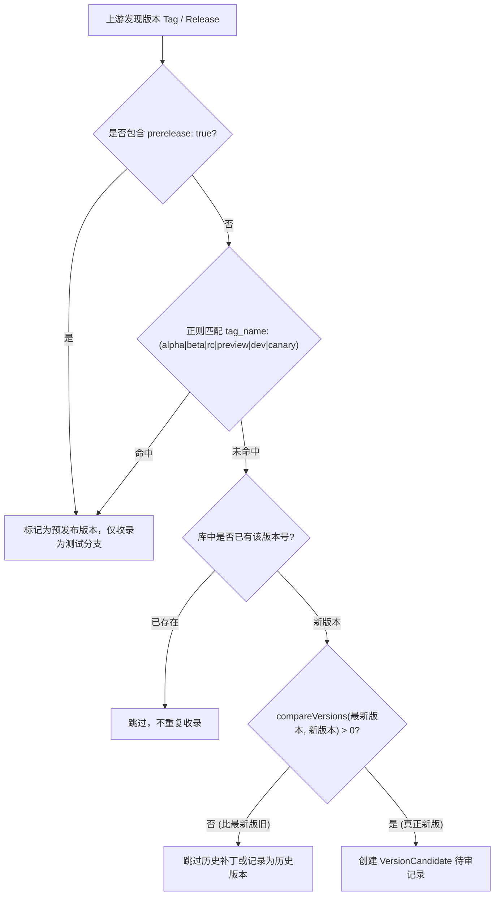
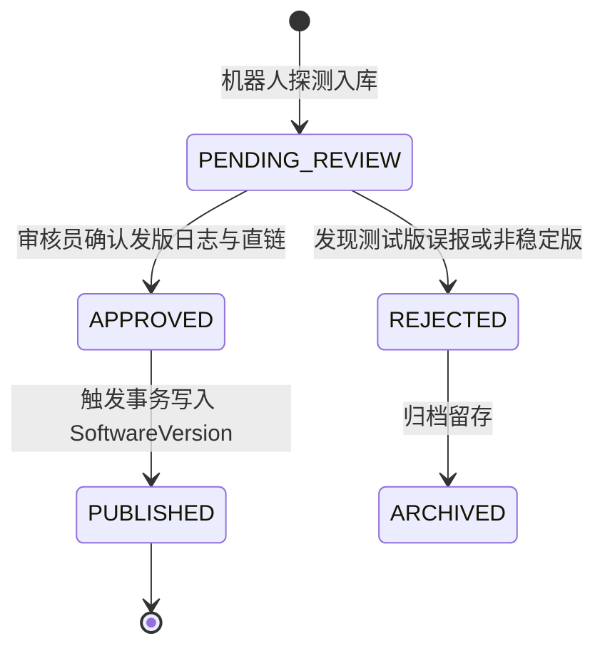

# 软游部落 P9.0 —— 官方软件新版本自动监测与审核工作流方案

**文件标识**：ST-P90-VER-01  
**编制时间**：2026-11-12  
**责任角色**：Fastify / TypeScript 后端工程师 & 软件版本监控架构师  
**实施状态**：`STAGE_A_COMPLETED (本地引擎就绪，待生产授权上线)`

---

## 一、系统定位与业务目标

作为可信、长期维护的综合软件资源平台，软游部落必须确保展示给用户的软件版本兼具**最新性**与**稳定性**。版本监控体系的核心目标是：

1. **自动感知**：通过定时任务周期性扫描官方来源，自动发现上游新版本。
2. **智能分流**：准确区分「正式稳定版 (Stable)」与「预发布测试版 (Alpha/Beta/RC/Insiders)」，避免将测试版误推为主版本。
3. **版本比对**：内置健壮的语义化版本 (SemVer) 与日期版本比对算法，杜绝版本倒流与重复收录。
4. **人工审核工作流**：新发现版本一律进入 `VersionCandidate` 待审队列，由审核人员（REVIEWER / ADMIN）人工核验更新日志与哈希值后方可一键上线，实现「机器发现 + 人工把关」的可靠闭环。

---

## 二、官方数据源与抓取架构

系统通过 `SoftwareSource` 实体维护每个软件的上游版本追踪配置，支持以下四类追踪协议：

| 来源类型 (`sourceType`) | 适用场景 | 追踪原理与实现 | 频次建议 |
| :--- | :--- | :--- | :--- |
| `GITHUB_RELEASES` | 开源软件、独立开发者项目 | 调用 GitHub REST API `GET /repos/{owner}/{repo}/releases?per_page=10`，抓取 `tag_name`, `body`, `assets` | 每日 1 次 |
| `OFFICIAL_API` | 具备公开更新接口的商业软件 | 轮询官方 JSON/XML 版本接口（如 JetBrains, Mozilla, VSCode 更新检查点） | 每日 1 次 |
| `OFFICIAL_RSS` | 提供版本发布 RSS/Atom 的官网 | 解析 RSS XML 规范，提取 `<item>` 的标题与 `<pubDate>` | 每日 1 次 |
| `OFFICIAL_SCRAPE` | 仅有 HTML 下载页面的传统软件 | 基于 Cheerio 解析官方固定 CSS 选择器（如 7-Zip, CPU-Z） | 每日 1 次 |

### 防抖与限速控制
- 遵循 HTTP 规范，请求头携带标准 User-Agent：`SoftBuluo-VersionBot/3.0 (+https://softtribe.top/health)`。
- 对于 GitHub API，支持配置通用 API Token 避免触发 60次/小时 的非认证速率限制。
- 探测间隔严格设为 24 小时（86400 秒），避免频繁轮询引发上游封锁。

---

## 三、版本号比较与稳定版智能分类算法

### 3.1 语义化版本比对 (`compareVersions`)
算法剥离前缀 `v`、去除后缀标识符，将版本切分为数字段逐级比对：
```typescript
export function compareVersions(current: string, candidate: string): number {
  const cleanVer = (v: string) => v.trim().replace(/^v/i, '').replace(/[-_].*$/, '');
  const cClean = cleanVer(current);
  const nClean = cleanVer(candidate);
  if (cClean === nClean) return 0;

  const cParts = cClean.split('.').map((p) => parseInt(p, 10) || 0);
  const nParts = nClean.split('.').map((p) => parseInt(p, 10) || 0);

  const maxLen = Math.max(cParts.length, nParts.length);
  for (let i = 0; i < maxLen; i++) {
    const cVal = cParts[i] || 0;
    const nVal = nParts[i] || 0;
    if (nVal > cVal) return 1;  // candidate 新
    if (nVal < cVal) return -1; // candidate 旧
  }
  return candidate.localeCompare(current);
}
```

### 3.2 稳定版 vs 预发布版规则
官方软件更新常包含预览版（如 VS Code Insiders、Chrome Canary、Python RC）。为保护普通用户装机体验，版本抓取引擎执行两级过滤：



---

## 四、VersionCandidate 审核工作流状态机

候选版本从被发现到正式上线的全生命周期状态流转如下：



### 4.1 状态枚举与说明
- `PENDING_REVIEW`：新抓取的候选版本，已包含抓取日志、下载链接与来源 URL，等待管理员复核。
- `APPROVED`：审核员确认真实性并点击批准。
- `REJECTED`：审核员判定不适合发布（如存在重大 Bug 撤包、非稳定版或恶意篡改）。
- `ARCHIVED`：历史处理记录已归档。

### 4.2 审批通过时的原子性数据库事务
审核员批准通过时，后端通过 `prisma.$transaction` 保证以下 4 步原子生效：
1. 更新 `VersionCandidate.reviewStatus = APPROVED`，记录 `reviewerId` 与 `reviewedAt`。
2. 将该软件现有所有版本的 `isLatest` 字段置为 `false`。
3. 新增 `SoftwareVersion` 记录，标记 `version = candidate.version`，`isLatest = true`，并附带更新说明。
4. 若候选附带官方直链，新增对应的 `DownloadSource` 记录，`verificationStatus = VERIFIED`。
5. 自动向运营总线发出一条 `VERSION_PUBLISHED` 通知，并在「最新更新 (/updates)」频道生成时间线事件。

---

## 五、后台运营工作台接口与规范

版本审核后台主要通过以下 Fastify 接口与前端管理台交互：

- `GET /api/v1/admin/version-monitor/candidates`：分页获取待审候选版本列表（可按软件名称、状态筛选）。
- `POST /api/v1/admin/version-monitor/check/:softwareId`：针对指定软件手动触发一次即时上游版本扫描。
- `POST /api/v1/admin/version-monitor/candidates/:id/review`：提交审核决议：
  ```json
  {
    "action": "APPROVE", // 或 "REJECT"
    "reviewNotes": "已核验 VS Code 官方 1.89.0 发布说明与签名无误",
    "createDownloadSource": true,
    "directDownloadUrl": "https://update.code.visualstudio.com/1.89.0/win32-x64-user/stable"
  }
  ```

---

## 六、生产发布与演练检查清单

- [x] 本地单元与集成测试 100% 覆盖版本比较、过滤与审核流转（Suite 28 维度 12-16 全部通过）。
- [ ] 生产环境部署后，首批针对 `VS Code`、`Git`、`7-Zip` 3 款开源代表性软件执行演练。
- [ ] 确保抓取机器人无法直接修改生产公开资源的 `isLatest` 字段，必须强制经过后台审核。
